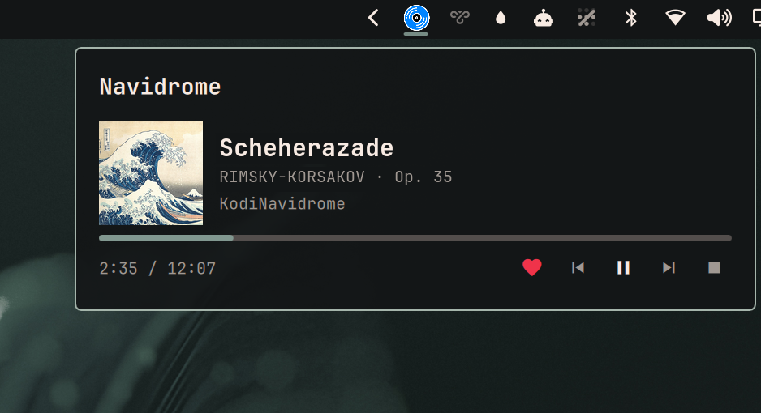

# Navidrome Remote

Omarchy bar widget showing what is playing on your Navidrome server from **any**
device — Kodi, a phone, a tablet, cliamp — with a live progress bar, and
transport controls for clients that can actually be controlled.

Hidden while nothing is playing.



## Install

```bash
omarchy plugin add https://github.com/Kyrunner/omarchy-navidrome-remote.git --enable
```

## Setup

Create `~/.config/omarchy-navidrome/config.json`:

```json
{
  "url": "http://192.168.1.10:4533",
  "public_url": "https://nd.example.com",
  "user": "you",
  "password": "...",
  "controllers": [
    {
      "player": "KodiNavidrome",
      "type": "kodi",
      "url": "http://192.168.1.20:8080",
      "user": "kodi-web-user",
      "password": "kodi-web-password"
    }
  ]
}
```

`chmod 600` it.

| Key | Meaning |
|-----|---------|
| `url` | LAN address, polled all day. Keep this local — see below. |
| `public_url` | Optional. Used only when the LAN address is unreachable, so the widget keeps working away from home. |
| `user` / `password` | Navidrome login. Sent as Subsonic token auth (`md5(password + salt)`, fresh salt per request), never as the password itself. |
| `controllers` | Optional. One entry per client you want to control. |

### Controllers

`player` must match the player name Navidrome reports, which you can read
straight off the API:

```bash
./backend.sh | python3 -m json.tool | grep player
```

Only `"type": "kodi"` is implemented. Kodi needs *Settings → Services → Control →
Allow remote control via HTTP* turned on, and the username/password you set
there go in `user`/`password`.

### Clients that only report at track start

Some Subsonic clients — `play:Sub` on iOS is one — send a single now-playing
report when a track begins, and nothing afterwards. No pause, no resume, no stop.

Navidrome extrapolates position from that one report, caps it at the track
duration, and then deletes the entry. The practical consequences:

- The row disappears when the track *would* have ended, whether or not it did.
- **Resuming a paused track will not bring the row back.** The client never tells
  the server, so the server cannot tell this widget. Skipping to the next track
  does work, because a new track triggers that one report.
- While paused, the row keeps reading as playing with a moving progress bar,
  until it reaches the end.

None of this is fixable from the plugin — the information never leaves the
phone. A client that re-reports periodically behaves correctly, as does Kodi,
which is asked directly on every poll.

**Most Subsonic clients cannot be controlled at all.** Subsonic is a streaming
protocol with no transport endpoints — the server does not own playback, so
there is nothing to send a pause to. Phone and tablet apps generally expose no
remote API. For those sessions the widget shows everything and disables the
buttons with the reason.

## Using it

| | |
|---|---|
| Bar | Vinyl icon while something is playing, dimmed when paused, hidden when idle |
| Bar badge | Count, when more than one device is playing |
| Bar, red `!` | Dimmed icon and a red badge: open the popup, it names the problem |
| Click | Show every active session |
| Click the title | Open that album in Navidrome in your browser |
| ♥ | Add to / remove from favourites. Works even for sessions you cannot control. |
| ⏮ ⏸ ⏭ ⏹ | Previous / play-pause / next / stop, for controllable sessions |
| `Space` in popup | Play-pause the first controllable session |
| Middle-click | Refresh now |
| `r` in popup | Refresh now |
| `Esc` | Close |

## Two endpoints, and why the order matters

At a 5s poll this widget makes **17,280 requests a day**. Sent through a public
edge running a rate limiter or an IP-ban daemon, that is a steady drum on your
own defences, and tripping them bans you from your own server. So the LAN
address is always tried first, and `public_url` is a fallback rather than an
equal option. On the public path the poll backs off to 20s.

The choice is remembered in `~/.local/state/omarchy-navidrome/endpoint.json`,
because the backend runs as a fresh process on every poll and would otherwise
pay a LAN timeout on every single poll while you are away. After a fallback it
stays on the public endpoint for 10 minutes, then re-probes the LAN — so walking
back in the front door restores the fast path on its own.

Bad credentials are never failed over to the public endpoint. Retrying a wrong
password against your own public edge is a good way to get banned by it.

## Dependencies

| | |
|---|---|
| Navidrome | Developed against **0.63.2**. Needs `positionMs`/`state` in `getNowPlaying`, which Navidrome adds beyond stock Subsonic. |
| `bash`, `python3` | Standard library only — nothing to `pip install`. |
| Kodi | Optional, only for control. JSON-RPC tested against **13.10**. |

The bar icon is an SVG, needing `qt6-svg` — already a hard dependency of
`quickshell`.

## Removing it

```bash
omarchy plugin remove ky.navidrome-remote
rm -rf ~/.config/omarchy-navidrome ~/.local/state/omarchy-navidrome
```

The plugin only ever writes inside `~/.local/state/omarchy-navidrome/`. It reads
its config and never edits it.

## Debugging

`backend.sh` is the whole network surface, so it can be run over SSH:

```bash
./backend.sh                                  # every active session, as JSON
./backend.sh control KodiNavidrome playpause  # play/pause
./backend.sh control KodiNavidrome next
./backend.sh control KodiNavidrome previous
./backend.sh control KodiNavidrome stop
./backend.sh star <songId>                    # favourite a track
./backend.sh unstar <songId>
```

Failures are distinct on purpose — `not configured`, `unreachable`,
`auth failed`, `no controller configured for X`, `controller unreachable` —
because a dead server and a quiet one must never look the same.

State lives in `~/.local/state/omarchy-navidrome/`:

- `endpoint.json` — which endpoint last worked. Delete to force a LAN re-probe.
- `covers/` — cover art cache, capped at 100 files, oldest evicted first.
- `starred.json` — per-track favourite state, 30s TTL. Safe to delete; it refills.

## Design

See [DESIGN.md](DESIGN.md) for why display is universal but control is not, how
the endpoint fallback works, and how "no remote API" is told apart from
"unreachable from here".

## Icon

`navidrome.svg` is from [dashboard-icons](https://github.com/homarr-labs/dashboard-icons)
(Apache 2.0).

## Preview image

`preview.png` uses Hokusai's *The Great Wave off Kanagawa* (1831) as cover art
and Rimsky-Korsakov's *Scheherazade* Op. 35 (1888) as the track — both public
domain. No studio artwork is reproduced anywhere in this repository.
